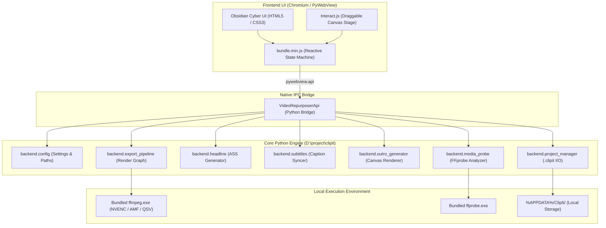

<div align="center">

```
   ______  __     ________  ____  ______ 
  / ____/ / /    /  _/ __ \/  _/ /_  __/ 
 / /     / /     / // /_/ // /    / /    
/ /___  / /___ _/ // ____// /    / /     
\____/ /_____//___/_/   /___/   /_/      
     VERTICAL MOTION STUDIO PRO          
```

# 🎬 ClipIt — Vertical Motion Studio Pro

### *Next-Generation Desktop Workstation for Repurposing Landscape Footage into Viral 9:16 Vertical Content.*

[](https://github.com/AIwolfie/clipit)
[](https://python.org)
[](https://ffmpeg.org)
[](https://microsoft.com/windows)
[-f43f5e.svg?style=for-the-badge&logo=github&logoColor=white)](https://github.com/AIwolfie)
[](https://aiwolfie.online)

---

[Key Capabilities](#-key-capabilities) •
[Architecture Blueprint](#-architecture-blueprint) •
[Quickstart](#-quickstart--installation) •
[Keyboard Shortcuts](#-keyboard-shortcuts) •
[Project File Anatomy](#-project-file-anatomy) •
[Author & License](#-author--credits)

</div>

---

## ⚡ What is ClipIt?

**ClipIt** is a studio-grade desktop video suite engineered from the ground up for high-velocity creators, streamers, and marketing teams. It automates the complex multi-layer composition pipeline required to convert standard 16:9 landscape videos into dynamic 9:16 short-form masterworks for **TikTok**, **Instagram Reels**, and **YouTube Shorts**.

Powered by a hybrid **PyWebView (Edge Chromium)** front-end wrapped over a high-throughput **Python 3.13 + FFmpeg 7.x** hardware-accelerated processing engine, ClipIt delivers fluid 60 FPS visual editing with instant GPU rendering.

---

## 🚀 Key Capabilities

### 📱 1. Intelligent 9:16 Mobile Canvas & Stage Engine
- **Interactive Multi-Touch Viewport:** Visual drag-and-drop bounding box repositioning, smooth zoom levels, and aspect-ratio locking.
- **Smart Adaptive Backgrounds:** Automatically fills empty vertical pillarbox margins with real-time dynamic **Gaussian Blur**, solid obsidian slate, or customizable dual-stop gradients.
- **Split & Centered Modes:** Instantly toggle between split-screen multi-cam layouts and centered focal tracking.

### ✍️ 2. Dynamic Headline & Typography Studio
- **Rich Vector Text Engine:** Multi-line header banners with independent color stops, stroke borders, drop-shadows, and tracking.
- **23 Curated Font Families:** Bundled zero-install fonts (`Inter`, `SF Pro Display`, `Montserrat`, `Poppins`, `Bebas Neue`, `Instrument Serif`, `Geist`, `SF Mono`).
- **Glow & Gradient Mattes:** Corner-frame mattes and frosted-glass header backdrops.

### 💬 3. Synchronized Animated Subtitles & Captions
- **SubRip (.srt) Import & Auto-Parser:** Reads industry-standard subtitle streams and generates high-impact, karaoke-style highlighted words.
- **Micro-Timing Synchronization:** Millisecond subtitle offset calibration to lock words tightly to the spoken dialogue.
- **Typography Casing Controls:** Instant one-click transforms between `ALL CAPS`, `Title Case`, and `sentence case`.

### 🐦 4. Integrated Social Proof & Tweet Cards
- **Pixel-Perfect Tweet Cards:** Render real or synthetic social posts directly onto video tracks, complete with verified badges, profile avatars, timestamp stamps, and metric pills.
- **Theme Support:** Clean light and dark glassmorphic social cards.

### 🎵 5. Audio Engineering & Loudness Normalization
- **Intelligent Ducking Assistant:** Ingest background music tracks (`.mp3`, `.wav`, `.aac`) with automatic volume suggestions calculated from foreground voice energy.
- **Precision Trimmer:** Visual waveform scrub timeline with instant `[I]` (In-Point) and `[O]` (Out-Point) hotkey markers.

### 🏆 6. Branded Outro & End-Card Generator
- **Motion Outro Sequences:** Automatically appends branded ending call-to-actions with custom channel logos, social handles, and follow buttons.
- **Asset Library:** Built-in repository of Apple-style emojis and official social media vector badges.

### ⚡ 7. Hardware-Accelerated FFmpeg Export Pipeline
- **Multi-Vendor GPU Acceleration:** Native detection and routing for **NVIDIA NVENC** (`hevc_nvenc`, `h264_nvenc`), **AMD AMF**, and **Intel QSV**.
- **Real-Time Telemetry:** Background asynchronous encoding with live percentage feedback, speed multipliers, and instant cancellation controls.
- **Zero Third-Party Cloud Bloat:** 100% private, local execution. No watermarks, no upload limits, and no server telemetry.

---

## 🏛 Architecture Blueprint

ClipIt marries modern web UI ergonomics with low-latency bare-metal system capabilities:



---

## ⌨️ Keyboard Shortcuts

Speed is everything in content production. ClipIt provides complete hotkey coverage:

| Shortcut | Action | Description |
| :--- | :--- | :--- |
| <kbd>Ctrl</kbd> + <kbd>N</kbd> | **New Project** | Wipes stage and prompts for video import |
| <kbd>Ctrl</kbd> + <kbd>O</kbd> | **Open Project** | Loads an existing `.clipit` project file |
| <kbd>Ctrl</kbd> + <kbd>S</kbd> | **Save Project** | Saves working session and timeline state |
| <kbd>Ctrl</kbd> + <kbd>Shift</kbd> + <kbd>S</kbd> | **Save As** | Saves session to a new custom location |
| <kbd>Ctrl</kbd> + <kbd>M</kbd> | **Export Dialog** | Opens custom bitrate, resolution & encoder modal |
| <kbd>Ctrl</kbd> + <kbd>Shift</kbd> + <kbd>M</kbd> | **Quick Export** | Instantly kicks off GPU render using active preset |
| <kbd>Ctrl</kbd> + <kbd>Z</kbd> | **Undo** | Reverts last canvas transform or setting change |
| <kbd>Ctrl</kbd> + <kbd>Y</kbd> | **Redo** | Reapplies reverted action |
| <kbd>Space</kbd> | **Play / Pause** | Toggles video playback on stage canvas |
| <kbd>I</kbd> | **Mark In-Point** | Trims starting timestamp of active clip |
| <kbd>O</kbd> | **Mark Out-Point** | Trims ending timestamp of active clip |
| <kbd>Ctrl</kbd> + <kbd>L</kbd> | **Live Preview** | Toggles 1:1 true-size 9:16 vertical overlay |
| <kbd>Ctrl</kbd> + <kbd>`</kbd> | **Fullscreen** | Expands viewport to borderless fullscreen player |
| <kbd>?</kbd> | **Shortcuts** | Displays in-app shortcut cheat sheet |

---

## 📁 Project File Anatomy

```
D:\project\clipit\
├── assets/                     # UI icons, branding, emojis & vector badges
│   ├── app.ico                 # Multi-res Windows desktop icon (16-256px)
│   ├── app_icon.png            # 512x512 ClipIt master brandmark
│   ├── clipit_logo.png         # Vector brand logo
│   ├── emojis/                 # High-resolution Apple-style emoji catalog
│   └── icons/social/           # Official SVG/PNG social badges (TikTok, YouTube, etc.)
├── backend/                    # Core Python processing pipelines
│   ├── __init__.py             # Package declaration
│   ├── config.py               # Metadata, path resolvers & GDI font registry
│   ├── time_bomb.py            # License controller (Lifetime Active)
│   ├── updater.py              # In-app local release manager
│   ├── core.pyc                # VideoRepurposerApi bridge implementation
│   ├── export_pipeline.pyc     # Complex FFmpeg filtergraph compiler
│   ├── media_probe.pyc         # FFprobe stream & codec inspector
│   ├── headline.pyc            # Rich-text ASS headline layout engine
│   ├── subtitles.pyc           # Subtitle alignment & ASS caption generator
│   ├── outro_generator.pyc     # End-card renderer & keyframe animator
│   ├── project_manager.pyc     # Project I/O, recent projects & autosave
│   ├── fonts.pyc               # System & local font mapper
│   └── ffmpeg_engine.pyc       # FFmpeg subprocess coordinator
├── fonts/                      # 23 bundled typography font families
├── vendor/                     # Runtime UI libraries
│   ├── interact.min.js         # Canvas physics, dragging & resizing
│   └── lucide.min.js           # Lightweight vector icon library
├── bundle.min.css              # Structural baseline styles
├── clipit_theme.css            # ClipIt Cyber Indigo & Neon Cyan modern theme
├── bundle.min.js               # Reactive client state controller
├── ffmpeg.exe                  # Standalone 64-bit FFmpeg binary
├── ffprobe.exe                 # Standalone 64-bit FFprobe binary
├── index.html                  # Main workstation application window
├── main.py                     # Desktop controller (PyWebView + Edge Chromium)
├── README.md                   # Workstation documentation
└── run_clipit.bat              # One-click Windows launch script
```

---

## 💻 Quickstart & Installation

### Requirements
- **Operating System:** Windows 10 / Windows 11 (64-bit)
- **Python:** Version 3.10 or higher
- **GPU (Optional):** NVIDIA, AMD, or Intel dedicated GPU for hardware acceleration

### Step 1: Clone or Navigate to Directory
```powershell
cd "D:\project\clipit"
```

### Step 2: Install Runtime Packages
```powershell
pip install pywebview resvg_py pillow
```

### Step 3: FFmpeg Engine (GPU Accelerated)
If FFmpeg is already installed on your system or available in your PATH, ClipIt detects and routes to it automatically.
To download and extract the standalone binaries into the workspace in one click:
```powershell
.\setup_ffmpeg.bat
```
*(Or install globally via Windows Package Manager: `winget install Gyan.FFmpeg`)*

### Step 4: Launch ClipIt
Simply double-click:
```powershell
.\run_clipit.bat
```
Or launch directly from terminal:
```powershell
python main.py
```

---

## 👨‍💻 Author & Credits

<div align="center">

Developed with craft by **[AIwolfie (Mayank Malaviya)](https://github.com/AIwolfie)**

🌐 **Official Website:** [aiwolfie.online](https://aiwolfie.online)  
🐙 **GitHub Profile:** [@AIwolfie](https://github.com/AIwolfie)  
📦 **Repository:** [AIwolfie/clipit](https://github.com/AIwolfie/clipit)

---

*ClipIt Studio Pro is released under the **MIT License**. Free for individual, agency, and commercial video production.*

</div>
